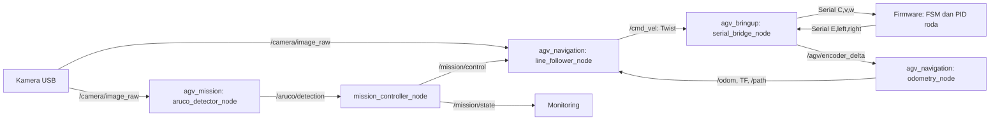

# Panduan Teori dan Implementasi AGV

Dokumen ini menjelaskan hubungan antara teori robot bergerak dan implementasi
yang saat ini ada di `firmware/` serta paket modular `agv_*` pada
`ros2_ws/src/`. Ini adalah penjelasan atas kode, bukan pengganti hasil ukur
fisik. Angka pada konfigurasi aktif, nilai nominal komponen, dan hasil kalibrasi
empiris dapat berbeda; perbedaannya dirangkum di bagian [Catatan konsistensi](#catatan-konsistensi-dan-hal-yang-perlu-diverifikasi).

## 1. Arsitektur sistem

Robot memakai penggerak differential drive: dua roda kiri dan kanan dikendalikan
terpisah, sedangkan roda bebas menjaga keseimbangan. Kamera dan encoder memberi
masukan kepada node ROS 2; node navigasi dan misi menghasilkan perintah gerak;
firmware mengatur kecepatan roda dan mengirim kembali hitungan encoder.



`agv_bringup/launch/agv_core.launch.py` hanya menjalankan kamera dan serial
bridge. Node odometri, line follower, detektor ArUco, dan mission controller
dijalankan terpisah. Tidak ada command mux di antara `/cmd_vel` dan serial
bridge: selama uji manual, pastikan hanya satu sumber yang menerbitkan perintah
gerak.

## 2. Konvensi, pesan, dan topik

Konvensi target sistem adalah ROS REP-103: `linear.x > 0` berarti maju;
`angular.z > 0` berarti yaw positif, yaitu putar kiri/CCW; `angular.z < 0`
berarti putar kanan/CW. Satuan kecepatan adalah m/s dan rad/s.

Pesan custom di `agv_interfaces`:

| Pesan | Field | Fungsi |
| --- | --- | --- |
| `ArucoDetection` | `id`, `distance_m` | Satu marker yang terdeteksi dan jarak optiknya. Satu pesan diterbitkan per marker, bukan satu array per frame. |
| `MissionState` | `state`, `current_waypoint` | Ringkasan state misi dan ID waypoint target. State berupa string bebas, bukan enum tervalidasi saat kompilasi. |

Topik utama:

| Topik | Tipe | Produsen → konsumen |
| --- | --- | --- |
| `/camera/image_raw` | `sensor_msgs/Image` | `camera_node` → line follower dan ArUco |
| `/cmd_vel` | `geometry_msgs/Twist` | Line follower atau alat uji → serial bridge |
| `/agv/encoder_delta` | `Int64MultiArray [left,right]` | Serial bridge → odometri |
| `/odom` | `nav_msgs/Odometry` | Odometri → line follower dan konsumen lain |
| `/path` | `nav_msgs/Path` | Odometri → RViz/monitoring |
| `/aruco/detection` | `ArucoDetection` | Detektor → mission controller |
| `/mission/control` | `std_msgs/String` | Mission controller → line follower |
| `/mission/state` | `MissionState` | Mission controller → monitoring |
| `/line_follower/state` | `std_msgs/String` | Line follower → mission controller |

Untuk gambar, publisher kamera memakai antrean satu pesan dan QoS Reliable;
subscriber vision memakai QoS Best Effort dengan antrean satu. Pola ini
mengutamakan frame terbaru dan mengizinkan frame lama dibuang jika pemroses
tertinggal.

## 3. `agv_bringup`: perangkat kamera dan serial

### 3.1 Akuisisi kamera

`agv_bringup/agv_bringup/camera_node.py` membuka kamera V4L2 melalui OpenCV,
mencoba mengatur format FOURCC, resolusi, FPS, dan buffer, membaca frame,
mengonversinya ke pesan ROS BGR8, lalu menerbitkan `/camera/image_raw`.
Parameter aktif berada di `agv_bringup/config/camera_params.yaml`.

Buffer pendek mencegah antrean frame lama. Format `YUYV` menghindari masalah
decode JPEG yang pernah muncul saat MJPEG dipakai, tetapi memindahkan lebih
banyak data melalui USB. Nilai yang dilaporkan oleh `CAP_PROP_FPS` adalah mode
yang dipilih/dilaporkan backend; laju nyata tetap perlu diukur dengan
`ros2 topic hz /camera/image_raw`.

### 3.2 Jembatan serial

`serial_bridge_node.py` menerjemahkan `Twist` menjadi frame ASCII
`C,<linear_x>,<angular_z>\n`. Sebaliknya, ia membaca byte serial tanpa menunggu
(`timeout=0`), mengumpulkan byte sampai newline, memeriksa frame `E`, lalu
menerbitkan pasangan tick encoder. Buffer stream menangani kasus satu frame
serial terbagi ke beberapa pembacaan.

Timer 20 ms membaca serial. Jika tidak ada perintah `/cmd_vel` lebih dari 250
ms, bridge mengirim heartbeat nol berkala. Ini menjaga firmware menerima frame
valid ketika sistem idle. Bridge juga menerbitkan salinan tick ke topik legacy
`/line_tracker/encoder_delta`.

### 3.3 Launch dan batas ownership

Launch `agv_core.launch.py` membaca dua YAML dari package share dan menyalakan
kamera serta serial bridge. Launch ini tidak menyalakan seluruh misi. Tidak ada
arbiter yang memadukan kontrol manual, PID garis, dan perintah misi; pilih satu
sumber `/cmd_vel` selama pengujian.

## 4. `agv_navigation`: line following dan odometri

### 4.1 Deteksi garis: ROI, threshold, dan centroid

Line follower mengubah frame BGR menjadi grayscale, mengambil Region of
Interest (ROI) bawah gambar, melakukan Gaussian blur, lalu threshold Otsu
terbalik. Otsu memilih ambang intensitas berdasarkan histogram frame/ROI;
threshold terbalik membuat area gelap, seperti pita hitam, menjadi putih pada
mask.

Momen citra menghitung luas foreground `M00` dan centroid horizontal
`cx = M10/M00`. Error dinormalisasi terhadap pusat ROI:

```text
e = (cx - lebar_ROI/2) / (lebar_ROI/2)
```

Dengan definisi ini, `e > 0` berarti centroid garis berada di kanan, dan `e < 0`
berarti berada di kiri. Centroid memakai seluruh piksel foreground dalam ROI;
objek gelap lain atau garis bercabang yang melebar dapat menggeser pusat massa.
`M00 > 100` menjadi syarat minimum bahwa garis dianggap ditemukan.

### 4.2 Kontrol PID kemudi

`agv_navigation/agv_navigation/pid.py` menghitung kontrol diskrit:

```text
I[k] = clamp(I[k-1] + e[k] * dt, -1, 1)
D[k] = (e[k] - e[k-1]) / dt
u[k] = Kp*e[k] + Ki*I[k] + Kd*D[k]
```

Node line follower menerapkan tanda minus pada keluaran PID karena error kanan
memerlukan belok kanan (`angular.z < 0`):

```text
angular.z = clamp(-u, -max_angular_speed, +max_angular_speed)
```

Kecepatan maju dan kecepatan sudut punya peran berbeda: PID mengatur kemudi,
sedangkan status misi menentukan target kecepatan maju. `FOLLOW` menggunakan
`linear_speed`, `SLOW` menggunakan `slow_speed`, dan `STOP` menargetkan nol.
Pembatas akselerasi mengubah kecepatan maju maksimal `max_acceleration * dt`
per frame terproses. Tidak ada pembatas laju perubahan untuk `angular.z`.

Jika garis tidak ditemukan, node mempertahankan kecepatan dan kemudi sebelumnya
selama delapan frame terproses (*coasting*), lalu menerbitkan nol dan mereset
PID. Status yang diterbitkan antara lain `FOLLOWING`, `SLOWING`, `COASTING`, dan
`LINE_LOST`. Pemrosesan dibatasi oleh `processing_fps`; gambar debug hanya
dibuat/dikirim bila ada subscriber dan dibatasi oleh `debug_publish_rate_hz`.

### 4.3 Manuver belok dan penguncian ulang garis

Perintah `LEFT`/`TURN_LEFT` memilih `angular.z` positif; `RIGHT` memilih
negatif. Dalam state `TURN`, node berputar di tempat sampai perubahan yaw dari
`/odom` mencapai `turn_angle_rad`. Pengukuran selisih yaw dibungkus ke rentang
terpendek, sehingga target belok didukung sampai 180°. Jika `/odom` belum pernah
diterima, sudut diperkirakan dari `turn_speed_radps * waktu`.

Setelah sudut tercapai, node masuk `SEEK_LINE`. Ia melanjutkan putaran searah
yang sama dengan kecepatan lebih rendah sampai centroid garis berada dalam
toleransi pusat selama `reacquire_frames` frame. Bila batas sudut pencarian
atau timeout putar terlampaui, node menerbitkan `TURN_FAILED` dan nol ke
`/cmd_vel`. Selesai mengunci garis menghasilkan `TURN_COMPLETE`.

Belok dan pencarian garis dieksekusi dalam callback gambar. Karena itu
kelambatan/terputusnya kamera juga mengurangi frekuensi pembaruan perintah
belok, bukan hanya kualitas visualisasi.

### 4.4 Odometri differential drive

Serial bridge memberi delta tick bertanda kiri dan kanan. Jarak per tick,
perpindahan pusat robot, dan perubahan yaw dihitung dengan:

```text
s_tick = pi * D / CPR
dL = left_ticks  * s_tick
dR = right_ticks * s_tick
ds = (dL + dR) / 2
dtheta = (dR - dL) / b
```

Integrasi midpoint memproyeksikan perpindahan ke frame odom:

```text
x += ds * cos(theta + dtheta/2)
y += ds * sin(theta + dtheta/2)
theta += dtheta
```

Node menerbitkan `/odom`, TF `odom -> base_link`, dan `/path`. Kecepatan
linier/sudut dihitung dari delta pose dibagi waktu antarpesan encoder; `/path`
diterbitkan berkala dan dibatasi panjangnya oleh `max_path_poses`.

Integrasi ini mengasumsikan tick bertanda sesuai sisi dan arah fisik roda,
parameter diameter/CPR/wheel separation benar, dan slip kecil. Odometri roda
akan mengalami drift jika roda selip atau tick hilang. Pesan encoder tidak
membawa timestamp sampel, sehingga node memberi timestamp saat callback ROS
diterima.

## 5. `agv_mission`: marker dan FSM rute

### 5.1 Deteksi ArUco dan estimasi jarak

`aruco_detector_node.py` mengubah gambar menjadi grayscale dan mencari marker
menggunakan dictionary OpenCV `DICT_4X4_50` (parameter dictionary ID 0).
Ukuran sisi marker fisik `marker_length_m` harus sama dengan ukuran cetak.

Jika matriks kamera tersedia, `estimatePoseSingleMarkers` memakai parameter
intrinsics dan distorsi untuk memperoleh vektor translasi marker. Field
`distance_m` saat ini diisi dengan `tvec.z`: jarak sepanjang sumbu optik kamera,
bukan norma jarak 3D `sqrt(x²+y²+z²)`. Bila kalibrasi tidak tersedia, kode
memakai pendekatan `focal_length * ukuran_fisik / lebar_piksel` dengan focal
tetap 500 px.

Detektor memproses maksimal `processing_fps` gambar dan menerbitkan satu pesan
`ArucoDetection` untuk setiap marker yang ditemukan. Ia tidak menerbitkan
pesan “tidak ada marker”. Gambar debug bersifat opsional: salinan frame,
bounding marker, sumbu pose, dan teks dibuat hanya saat ada subscriber serta
dibatasi oleh `debug_publish_rate_hz`.

### 5.2 Mission controller sebagai finite-state machine

`mission_controller_node.py` membaca urutan paralel `route_ids` dan
`route_actions`. Setiap route ID harus punya satu aksi: `straight`, `left`,
`right`, atau `stop`.

Alur implementasi:

1. Misi dengan rute nonkosong mulai pada `NAVIGATING` dan mengirim `FOLLOW`.
2. Hanya ID waypoint aktif yang dihitung; ID lain diabaikan.
3. Untuk waypoint aktif, deteksi dihitung sampai `confirm_frames`. Jika tidak
   ada deteksi selama `detection_timeout_sec`, kandidat direset.
4. Pada jarak `<= slow_distance_m`, state menjadi `APPROACHING` dan controller
   mengirim `SLOW`.
5. Pada jarak `<= trigger_distance_m`, ID masuk `visited_ids` agar tidak
   memicu ulang, lalu aksi route dijalankan.
6. `straight` masuk `TRANSIT`, menahan kecepatan lambat selama
   `transit_hold_sec`, kemudian maju ke waypoint berikutnya.
7. `left`/`right` masuk `TURNING` dan meminta manuver kepada line follower.
   `TURN_COMPLETE` memajukan rute; `TURN_FAILED` mengakhiri misi dalam `ERROR`.
8. `stop`, atau waypoint terakhir apa pun aksinya, menghasilkan `ARRIVED` dan
   mengirim `STOP`.

`MissionState` diterbitkan pada 2 Hz dan juga saat transisi. `current_waypoint`
tetap menunjuk target aktif selama `APPROACHING`, `TRANSIT`, dan `TURNING`;
nilainya `-1` pada `IDLE`, `ERROR`, atau `ARRIVED`.

### 5.3 Debounce dan latch

Debounce mengurangi pemicu palsu akibat satu deteksi sesaat. Implementasi
menghitung pesan untuk ID yang sama dan me-reset setelah timeout. Karena detektor
tidak menerbitkan frame kosong dan controller tidak mengetahui nomor frame,
mekanisme ini bukan bukti matematis bahwa marker terlihat pada tiga frame
berurutan; pesan berjarak sampai timeout masih dapat dihitung sebagai rangkaian
yang sama. `visited_ids` merupakan latch permanen selama satu proses misi.
Karena itu ID pada `route_ids` harus unik jika setiap ID hanya boleh dipakai
sekali.

## 6. Firmware Arduino Mega

### 6.1 Setup, loop, dan state sistem

`firmware/src/main.cpp` menginisialisasi `Serial` untuk debug, `Serial1` untuk
ROS, dua driver motor, tombol, dan FSM. Loop utama membaca tombol, menangani
byte serial, lalu menjalankan update FSM. State firmware adalah `IDLE`,
`MOVING`, `ERROR`, dan `ESTOP`. `ERROR` tersedia pada enum dan dapat di-reset,
tetapi pada kode saat ini tidak ada jalur yang mengubah state ke `ERROR`.

Start/Stop fisik memindahkan `IDLE <-> MOVING`; E-stop memindahkan ke `ESTOP`;
Reset mengembalikan `ESTOP`/`ERROR` ke `IDLE`. E-stop firmware menghentikan
motor melalui output driver. Pemutusan daya motor secara fisik tetap perlu
dilakukan oleh rangkaian E-stop hardware bila keselamatan mengharuskannya.

### 6.2 Kinematika balik dan target encoder

Firmware mengubah kecepatan badan menjadi kecepatan roda differential drive:

```text
vL = v - omega * b/2
vR = v + omega * b/2
```

Lalu kecepatan roda dikalikan periode kontrol dan dibagi meter per tick untuk
mendapat target tick per siklus. Dengan frame serial konvensi CCW, `omega > 0`
seharusnya membuat roda kanan lebih cepat dan robot berputar kiri. Pemetaan
objek motor pada `main.cpp` saat ini ditukar terhadap nama kanal driver karena
hasil uji fisik sebelumnya menunjukkan arah kanal terpasang silang; perubahan
kabel harus diikuti uji arah dan tick ulang.

### 6.3 PID kecepatan roda

Setiap roda mempunyai PID terpisah dengan error `target_ticks - measured_ticks`.
Keluaran dijepit ke rentang PWM `[-255,255]`; tanda menentukan arah DIR dan
magnitudo menjadi PWM. Integral dibatasi `WHEEL_PID_MAX_INTEGRAL`. Nilai awal
gain firmware adalah `Kp=0.2`, `Ki=0`, `Kd=0`; ini adalah loop kecepatan roda,
terpisah dari PID kemudi garis di ROS.

### 6.4 Encoder dan driver motor

Encoder satu kanal dihubungkan ke interrupt eksternal Arduino Mega. ISR
menambah/mengurangi hitungan berdasarkan status pin arah motor, bukan fase
quadrature A/B. Ini praktis untuk mengetahui tanda gerak yang diperintahkan,
namun tidak dapat mengetahui arah roda yang diputar eksternal bila tidak sama
dengan status pin DIR.

`Motor::set()` memilih arah berdasarkan tanda PWM, mengatur pin DIR/PWM, dan
mengaktifkan START/STOP. `Motor::stop()` menonaktifkan START/STOP serta
mengatur PWM minimum. RUN/BRAKE ditetapkan saat `begin()` dan tidak diubah lagi
oleh kode runtime.

### 6.5 Parser serial dan watchdog

Parser firmware membaca ASCII sampai newline dengan buffer 48 byte. Frame
terlalu panjang dibuang sampai newline. Perintah hanya diterima bila format
`C,linear,angular` valid, kedua angka berhasil diparse dan finite. Firmware
mengirim `E,left_ticks,right_ticks` setiap siklus kontrol saat `MOVING`.

Jika tidak ada perintah valid selama 500 ms saat `MOVING`, watchdog firmware
menghentikan motor, mereset PID, dan membuang pulsa yang tertahan. Ini adalah
failsafe utama saat serial/ROS berhenti. Tidak ada checksum pada frame.

### 6.6 Tombol dan debouncing

`Button::loop()` menunggu level input stabil selama 50 ms sebelum menghasilkan
satu event tekan. Ini mengurangi beberapa event akibat bounce mekanis. Polaritas
active-low/active-high ditentukan saat `setup()`; E-stop disetel active-high,
sedangkan Start/Stop dan Reset active-low.

## 7. Alur operasi

1. Firmware dinyalakan; motor menunggu state `MOVING` dari tombol fisik Start.
2. Launch `agv_core` membuka kamera dan serial bridge.
3. Node odometri mengonsumsi tick encoder.
4. Line follower memproses kamera dan mengirim `/cmd_vel`.
5. Detektor menerbitkan marker; mission controller memilih aksi sesuai waypoint.
6. Perintah `SLOW`, `LEFT`, `RIGHT`, `FOLLOW`, atau `STOP` mengubah mode line
   follower. Firmware menerima kecepatan lewat serial dan menerapkan PID roda.
7. Tick encoder kembali ke odometri untuk memperbarui `/odom`, TF, dan `/path`.

Saat debugging, pisahkan tiap lapisan: cek `/camera/image_raw`, lalu
`/aruco/detection`, lalu `/mission/control`, `/cmd_vel`, serial/tick, dan
akhirnya `/odom`. Dengan urutan ini kegagalan persepsi dapat dibedakan dari
aksi misi, kontrol motor, atau skala odometri.

## 8. Catatan konsistensi dan hal yang perlu diverifikasi

| Temuan | Fakta implementasi/dokumen | Dampak dan tindak lanjut |
| --- | --- | --- |
| CPR firmware 900 vs odometri 610 | `firmware/include/config.h` menghitung nominal `30 × 30 = 900`; `pid_params.yaml` aktif memakai 610; `hardware.md` menyebut 610 hasil kalibrasi. | Ini nilai paling penting untuk disamakan setelah jumlah tick per satu putaran roda diukur langsung. Bila CPR fisik 610, target tick firmware 900 membuat skala kecepatan roda berbeda; bila 900, odometri 610 membesarkan jarak/yaw terhitung. Jangan mengubah keduanya tanpa pengukuran. |
| Wheel track 0,48 m vs 0,454 m | Firmware memakai 0,48; odometri aktif memakai 0,454. Hardware docs menyebut 0,48 dimensi fisik dan 0,454 nilai odometri hasil kalibrasi. | Nilai efektif odometri boleh berbeda dari jarak ukur fisik karena slip/geometri, tetapi perlu diberi nama/penjelasan berbeda. Selisih juga mengubah skala yaw dan kecepatan putar yang diminta firmware. |
| Arah kanal motor | `FSM fsm(motorLeft, motorRight)` menukar urutan objek terhadap nama parameter konstruktor; komentar menyebut harness silang. | Ini koreksi berbasis hasil uji di robot. Checklist meminta verifikasi arah setelah perubahan; ulangi uji `angular.z` positif dan negatif serta tanda tick `/odom` setelah firmware di-flash. |
| Hitungan 360° di dokumen | Checklist menandai 358,59° dan `b=0,454` selesai; hardware docs masih menyatakan uji putar belum divalidasi penuh; checklist juga meminta uji ulang arah setelah pemetaan kanal ditukar. | Catatan hasil lama tidak otomatis memvalidasi konfigurasi terkini. Ulangi putaran setelah pemetaan motor terakhir, dan catat arah serta sudut bertanda. |
| Kamera index/resolusi | `camera_params.yaml` aktif saat audit: index 0, 320×240, 30 FPS, YUYV. Nilai default di `camera_node.py` berbeda: index 2, 640×480, 30 FPS, MJPG. Checklist menyebut `/dev/video2`; riwayat uji menyebut index 3. | Launch aktif memuat YAML sehingga YAML mengalahkan default. OpenCV index dan `/dev/videoN` bergantung mesin. Gunakan log kamera dan `v4l2-ctl` pada robot aktual; perbarui checklist bila perangkat yang benar sudah pasti. |
| FPS konfigurasi vs laju ROS | Konfigurasi meminta 30 FPS, sedangkan pengukuran terakhir yang dilaporkan pada sesi ini `/camera/image_raw` sekitar 15 Hz. | FPS parameter/backend bukan jaminan throughput ROS. Gunakan `ros2 topic hz`; cek beban proses, frame size, dan subscriber bila laju aktual penting. ArUco dibatasi 20 FPS dan line follower 15 FPS. |
| Kalibrasi intrinsics resolusi | Matriks YAML ArUco 320×240 diperoleh dengan menskalakan matriks 640×480 sebesar 0,5; distorsi dipertahankan. | Ini benar jika mode 320×240 hanya menskalakan sensor tanpa crop/FOV berbeda. Validasi jarak marker dengan meteran atau kalibrasi ulang pada resolusi aktif. |
| Fallback jarak ArUco | Tanpa matriks, kode memakai focal tetap 500 px dengan komentar perkiraan 640×480; frame aktif 320×240. | Estimasi fallback dapat meleset besar pada resolusi aktif. Pastikan matriks kamera terpasang; lebih baik gagal eksplisit daripada mengandalkan focal default untuk jarak misi. |
| Arti `distance_m` | Nilai terkalibrasi adalah `tvec.z`, jarak sumbu optik, bukan jarak Euclidean marker. | Pada marker yang jauh dari tengah gambar/bersudut, ini berbeda dari jarak garis pandang. Ambang `trigger_distance_m` harus dikalibrasi dengan cara ukur yang sama. |
| Pesan deteksi tidak membawa waktu frame | `ArucoDetection` hanya berisi `id` dan `distance_m`; mission controller menghitung timeout dari waktu pesan diterima. | Timestamp sumber hilang, sehingga umur frame tidak bisa divalidasi end-to-end. Tambahkan `Header` atau timestamp/sequence jika perlu menolak deteksi usang secara ketat. |
| Debounce disebut “frame berturut-turut” | Misi menghitung pesan ID sama dan hanya reset setelah tidak terlihat lebih dari timeout 0,5 s. Detektor tidak mengirim pesan frame kosong atau frame ID. | Beberapa deteksi yang terpisah kurang dari 0,5 s tetap dapat dihitung; bukan strict consecutive frames. Jika jaminan frame berurutan diperlukan, kirim status visibilitas/timestamp per frame atau array deteksi kosong. |
| Stop misi vs ramp | Line follower punya slew limiter kecepatan maju, tetapi callback `STOP` langsung mengatur `current_linear_speed=0`. | Stop final sekarang memotong ramp dan menerbitkan nol segera, tidak melandai seperti deskripsi roadmap. Perlu pilih antara stop langsung yang aman atau deselerasi ramp yang benar-benar diimplementasikan. |
| Batas kehilangan garis | Toleransi adalah delapan frame *terproses*. Komentar menyebut sekitar 0,25 s pada 30 FPS; konfigurasi `processing_fps` sekarang 15. | Durasi efektif sekitar 0,53 s pada 15 FPS. Sebaiknya parameter waktu dipakai langsung atau komentar disesuaikan dengan FPS aktif. |
| Perintah belok bergantung gambar | State `TURN`/`SEEK_LINE` menerbitkan `/cmd_vel` hanya saat callback gambar berjalan. | Jika kamera tersendat, kontrol putar ikut tersendat; watchdog firmware kemudian menghentikan motor setelah 0,5 s tanpa frame perintah serial. Pengendali manuver berbasis timer akan lebih terpisah dari laju kamera. |
| Serial bridge reconnect dan timeout ROS | Node menyimpan parameter `timeout_sec` ke `watchdog_timeout` tetapi tidak menggunakannya; komentar menyebut reconnect, tetapi timer tidak memanggil ulang `_connect_serial()` setelah koneksi gagal/putus. | Parameter timeout yang efektif saat ini adalah konstanta firmware 500 ms. Koneksi serial yang gagal saat start tidak pulih otomatis; implementasikan retry atau koreksi komentar/parameter. |
| Heartbeat ROS dan watchdog firmware | Bridge mengirim nol setelah tidak menerima `/cmd_vel` 250 ms; firmware watchdog berhenti setelah 500 ms tanpa frame valid. | Jika callback line follower tertahan, bridge dapat mengirim nol sebelum watchdog firmware. Perilaku ini perlu diperhitungkan saat diagnosis “kamera lag menyebabkan robot berhenti”. |
| Periode target tick dan sampel PID firmware | Target tick dibuat dengan periode tetap 100 ms saat frame `C` diterima, sedangkan update PID memakai `elapsedMs` aktual sejak siklus kontrol sebelumnya. | Jika loop firmware tertunda jauh dari 100 ms, target per siklus dan jumlah tick terukur merujuk jendela waktu berbeda. Pertahankan loop periodik yang stabil atau skala target dengan periode kontrol aktual. |
| State dan field pesan bebas | `MissionState.state` dan status `String` bukan enum; route ID hanya divalidasi panjang/aksi, bukan duplikasi ID. | Salah eja status tidak tertolak saat build. ID berulang di rute akan dilewati karena `visited_ids` latch permanen. Validasi skema dapat diperketat. |
| Kehilangan garis tidak otomatis menggagalkan misi | Line follower menerbitkan `LINE_LOST`, tetapi parameter aktif `fail_on_line_lost` adalah `false`; mission controller hanya masuk `ERROR` atas kehilangan garis bila parameter itu aktif. | Robot dapat berhenti karena garis hilang sementara status misi tetap `NAVIGATING`/`APPROACHING`. Tentukan perilaku fail-safe yang diinginkan dan selaraskan status misi dengannya. |
| State firmware `ERROR` dan simbol lama | `ERROR` tidak dimasuki kode aktif; `eStopActive`, `previousState`, konstanta loading/rotasi, pin alarm, dan `SpeedMonitor` tidak dipakai oleh alur utama. | Jangan anggap fitur-fitur ini sudah menyediakan fault handling atau telemetri aktif. Hapus, integrasikan, atau dokumentasikan sebagai kode cadangan. |
| Polaritas tombol E-stop | Kode mengatur E-stop sebagai `INPUT_PULLUP` tetapi `activeLow=false` (event dianggap aktif saat pin HIGH). | Ini hanya benar bila rangkaian eksternal memang membuat level normal/aktif sesuai konfigurasi tersebut. Cocokkan dengan wiring dan uji fisik; E-stop keselamatan tetap harus memutus daya melalui rangkaian hardware. |
| Covariance odometri | `Odometry` dibuat tanpa mengisi covariance, sehingga field tetap nol. | Konsumen yang memakai covariance dapat menafsirkan data seolah tidak memiliki ketidakpastian. Isi kovarians empiris atau dokumentasikan bahwa odometri open-loop ini belum mengestimasi ketidakpastian. |
| Path dan memori | Pose path dipotong pada 10.000 sampel dan seluruh path dikirim setiap 0,5 s. | Memadai untuk demo singkat, tetapi pesan makin besar hingga batas; kurangi jumlah pose atau publish incremental untuk operasi lama. |
| Dokumentasi/perintah paket lama | `serial_protocol.md` masih menjelaskan `line_tracker_ros2/serial_bridge.py`; checklist menyebut camera `/dev/video2`; prosedur hardware merujuk launch paket lama. | Arsitektur aktif adalah `agv_bringup`, `agv_navigation`, `agv_mission`, tetapi paket lama tetap ada. Tandai contoh lama dengan jelas atau migrasikan agar teknisi tidak menjalankan dua stack. |
| Nilai tuning berbeda | Config line follower aktif: 0,18 m/s, `Kp=0,4`, `Kd=0,06`; checklist/roadmap memuat 0,20 m/s atau nilai awal lain. Mission aktif memakai 0,30/0,90 m, sedangkan roadmap historis menyebut ambang lain. | Dokumen prosedur lama adalah titik awal, bukan nilai aktif. Saat tuning, gunakan YAML node aktif sebagai sumber parameter runtime. |
| Default misi/odometri vs parameter aktif | Default mission controller adalah threshold 0,35/0,70 m; YAML aktif mengatur 0,30/0,90 m. Default odometri 0,48 m/900 CPR juga berbeda dari YAML aktif 0,454 m/610 CPR. | Menjalankan node tanpa `--params-file` mengubah perilaku dan skala. Selalu muat konfigurasi yang sesuai; untuk penggunaan rutin, satukan parameter dalam launch file. |
| Debug FPS default vs YAML | Line follower dan ArUco default ke 5 Hz; YAML aktif menetapkan 10 Hz. | Jika node dijalankan tanpa file parameter, debug terasa lebih lambat. Perintah launch/run harus memuat YAML yang benar. |
| Dependensi ROS belum lengkap | `serial_bridge_node.py` mengimpor `serial`, tetapi `agv_bringup/package.xml` tidak mendeklarasikan pyserial. Line follower mengimpor `SetParametersResult` dari `rcl_interfaces`, tetapi `agv_navigation/package.xml` tidak mencantumkannya. Detektor memakai `cv2` dan `numpy`, yang juga tidak dicantumkan eksplisit di `agv_mission/package.xml`. | Build pada mesin yang sudah memiliki dependensi transitif bisa berhasil, tetapi instalasi bersih/rosdep dapat gagal saat runtime. Deklarasikan dependensi runtime Python/ROS yang dipakai langsung. |
| Live parameter tuning parsial | Callback parameter line follower menerapkan `kp`, `ki`, `kd`, dan `linear_speed`; parameter lain yang dideklarasikan tidak disalin ke state runtime oleh callback. | Mengubah `slow_speed`, `max_acceleration`, ROI, FPS, atau parameter belok saat node berjalan mungkin mengubah nilai parameter ROS tanpa mengubah perilaku node. Restart setelah perubahan, atau lengkapi callback validasi/penerapan. |

## 9. Rujukan kode dan dokumen

- [Firmware README](../firmware/README.md), [konfigurasi firmware](../firmware/include/config.h), [FSM firmware](../firmware/src/app/fsm.cpp), [driver motor](../firmware/src/drivers/motor.cpp).
- [`agv_interfaces`](../ros2_ws/src/agv_interfaces/), [`agv_bringup`](../ros2_ws/src/agv_bringup/), [`agv_navigation`](../ros2_ws/src/agv_navigation/), [`agv_mission`](../ros2_ws/src/agv_mission/).
- [Parameter hardware](hardware.md), [protokol serial](serial_protocol.md), [roadmap](roadmap.md), dan [checklist](checklist.md).

