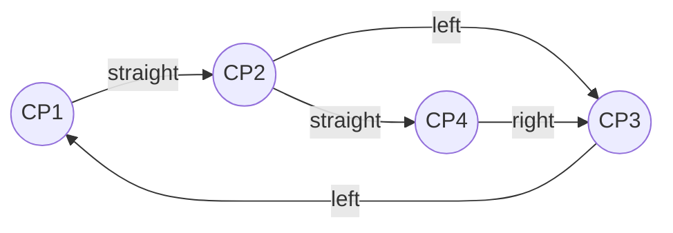
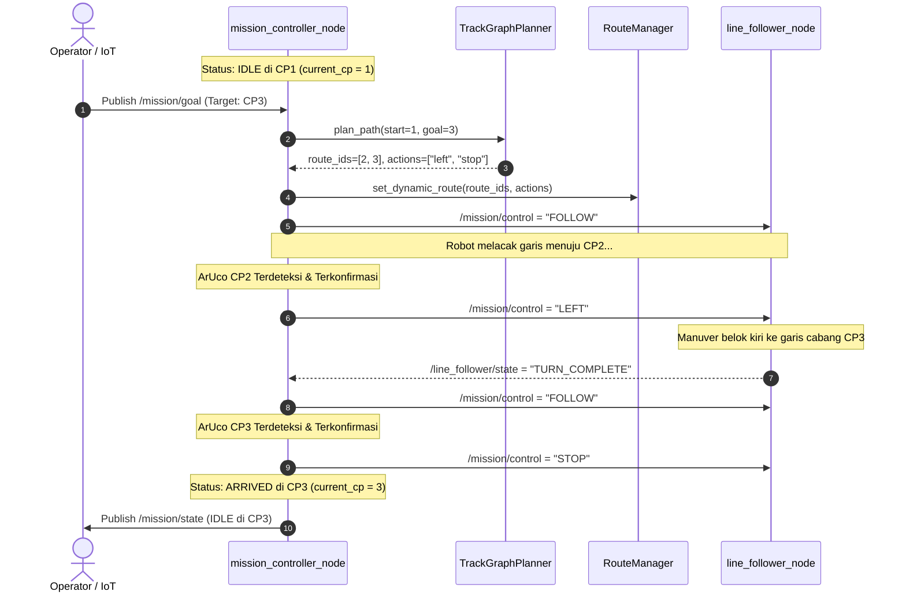

# Panduan Desain & Implementasi: Navigasi Waypoint Topologi Dinamis

Dokumen ini menjelaskan rancangan arsitektur, struktur data graf, algoritma pencari rute (*path planner*), serta langkah integrasi untuk mengubah sistem AGV dari **sekuens statis berurutan (*hardcoded sequence playback*)** menjadi **navigasi waypoint dinamis berbasis graf topologi lintasan (*topological waypoint navigation*)**.

Rancangan ini dibuat agar dapat diterapkan pada paket `agv_mission` di kemudian hari **tanpa mengubah firmware, serial bridge, detektor ArUco, maupun pengontrol pelacak garis (*line follower*)**.

---

## 1. Latar Belakang & Perbandingan Konseptual

### 1.1 Kondisi Saat Ini (Sekuens Statis)
Pada sistem aktif saat ini, rute didefinisikan secara linear di dalam konfigurasi (`route_scenario.yaml`):
```text
route_ids: [1, 2, 3]
route_actions: ["straight", "left", "stop"]
```
* **Kelemahan:**
  1. Robot hanya bisa berjalan dari index 0 ke 1, lalu ke 2.
  2. Robot tidak dapat diperintah secara acak (misalnya: saat di CP1 langsung disuruh ke CP3, atau dari CP3 kembali ke CP2).
  3. Robot tidak memiliki pemahaman tentang bentuk lintasan secara utuh; jika ada rute alternatif atau percabangan lain, robot tidak tahu cabang mana yang harus dipilih.

### 1.2 Target: Navigasi Waypoint Dinamis Berbasis Graf
Pada robot industri *Line-Guided AGV*, lintasan direpresentasikan sebagai **Graf Berarah (*Directed Graph*)**:
* **Simpul (*Node*):** Setiap titik persimpangan atau stasiun pemberhentian yang ditandai dengan marker ArUco (CP1, CP2, CP3, ...).
* **Sisi (*Edge*):** Garis pemandu fisik yang menghubungkan dua simpul. Setiap edge menyimpan informasi **arah aksi manuver** yang harus diambil saat meninggalkan simpul asal (`straight`, `left`, `right`, `u_turn`).



Dengan graf di atas:
* Robot berada di **CP1**.
* Operator atau IoT mengirim perintah: `Target: CP3`.
* Robot secara mandiri mencari rute terpendek: `CP1 -> CP2 -> CP3`.
* Aksi yang dieksekusi secara otomatis:
  1. Di CP1: ikuti garis lurus (`straight`) menuju CP2.
  2. Di CP2: belok kiri (`left`) menuju CP3.
  3. Di CP3: berhenti (`stop`) dan masuk ke kondisi `IDLE` menunggu perintah baru.

---

## 2. Struktur Data Peta Lintasan (YAML)

Peta lintasan dapat disimpan dalam file YAML terpisah, misalnya: `ros2_ws/src/agv_mission/config/track_graph.yaml`.

### 2.1 Format Definisi Graf
```yaml
# Definisi graf topologi lintasan AGV
# Format:
# from_node_id:
#   to_node_id:
#     action: "straight" | "left" | "right" | "u_turn"
#     distance_approx_m: perkiraan jarak garis (opsional, untuk pembobotan)

track_graph:
  1:
    2:
      action: "straight"
      distance_m: 2.0
  2:
    3:
      action: "left"
      distance_m: 1.5
    4:
      action: "straight"
      distance_m: 2.5
  3:
    1:
      action: "left"
      distance_m: 3.0
  4:
    3:
      action: "right"
      distance_m: 1.8
```

---

## 3. Algoritma Pencari Rute (*Path Planner*)

Pencarian rute dilakukan menggunakan algoritma **Breadth-First Search (BFS)** (untuk jumlah lompatan simpul paling sedikit) atau **Dijkstra** (jika memperhitungkan jarak fisik lintasan). Karena graf lintasan AGV indoor umumnya berskala kecil (3–20 checkpoint), BFS berjalan instan (< 1 ms).

### 3.1 Implementasi Mandiri Python (`TrackGraphPlanner`)
Modul ini dapat diletakkan di `agv_mission/agv_mission/graph_planner.py`:

```python
"""Modul perencana rute graf topologi untuk AGV berbasis ArUco."""

from collections import deque
from typing import Dict, List, Optional, Tuple


class TrackGraphPlanner:
    def __init__(self, graph_dict: Dict[int, Dict[int, dict]]):
        """
        Inisialisasi planner dengan adjacency dictionary graf.
        Contoh graph_dict:
        {
            1: {2: {'action': 'straight'}},
            2: {3: {'action': 'left'}, 4: {'action': 'straight'}},
            3: {1: {'action': 'left'}},
            4: {3: {'action': 'right'}}
        }
        """
        self.graph = graph_dict

    def plan_path(
        self, start_id: int, goal_id: int
    ) -> Tuple[Optional[List[int]], Optional[List[str]]]:
        """
        Mencari rute dari start_id menuju goal_id.
        Mengembalikan:
            (route_ids, route_actions)
            - route_ids: daftar checkpoint berikutnya yang harus diverifikasi.
            - route_actions: aksi manuver di setiap checkpoint tersebut.
        """
        if start_id == goal_id:
            return [], []

        if start_id not in self.graph:
            return None, None

        # Antrean BFS: menyimpan list node yang telah dilewati
        queue: deque = deque([[start_id]])
        visited = {start_id}

        while queue:
            current_path = queue.popleft()
            current_node = current_path[-1]

            if current_node == goal_id:
                return self._extract_route(current_path)

            for neighbor in self.graph.get(current_node, {}):
                if neighbor not in visited:
                    visited.add(neighbor)
                    new_path = list(current_path)
                    new_path.append(neighbor)
                    queue.append(new_path)

        # Tidak ada jalur yang menghubungkan start ke goal
        return None, None

    def _extract_route(self, path: List[int]) -> Tuple[List[int], List[str]]:
        """Mengonversi rangkaian simpul menjadi daftar ID target dan aksinya."""
        route_ids = path[1:]  # Checkpoint yang akan didatangi
        route_actions = []

        for i in range(len(path) - 1):
            u = path[i]
            v = path[i + 1]
            edge_info = self.graph.get(u, {}).get(v, {})
            if isinstance(edge_info, dict):
                action = edge_info.get("action", "straight")
            else:
                action = str(edge_info)
            route_actions.append(action)

        # Aksi di checkpoint terakhir tujuan selalu berhenti
        if route_actions:
            route_actions[-1] = "stop"

        return route_ids, route_actions
```

---

## 4. Alur Integrasi ke `agv_mission`

Berikut adalah diagram alur kerja saat robot menerima perintah target baru:



### 4.1 Modifikasi pada `RouteManager` (`route_manager.py`)
Tambahkan method untuk menyetel ulang rute secara dinamis tanpa perlu me-restart node:
```python
def set_dynamic_route(self, route_ids: list, route_actions: list):
    """Menyetel rute baru hasil kalkulasi path planner."""
    self.route = list(route_ids)
    self.actions = list(route_actions)
    self.index = 0
    self.visited_ids.clear()
    self.candidate_id = None
    self.candidate_count = 0
```

### 4.2 Modifikasi pada `MissionControllerNode` (`mission_controller_node.py`)
1. **Tambahkan Pelacakan Lokasi Terakhir:**
   ```python
   self.current_checkpoint = self.declare_parameter("initial_checkpoint", 1).value
   ```
2. **Langgan Topik Target Misi Baru:**
   ```python
   from std_msgs.msg import Int32

   self.create_subscription(Int32, "/mission/goal", self.goal_callback, 10)
   ```
3. **Callback Misi Target:**
   ```python
   def goal_callback(self, msg: Int32):
       target_id = msg.data
       if self.state not in ("IDLE", "ARRIVED"):
           self.get_logger().warn(
               f"Robot sedang menjalankan misi (state: {self.state}). Perintah diabaikan!"
           )
           return

       if target_id == self.current_checkpoint:
           self.get_logger().info(f"Robot sudah berada di Checkpoint {target_id}.")
           return

       route_ids, actions = self.planner.plan_path(self.current_checkpoint, target_id)
       if route_ids is None or len(route_ids) == 0:
           self.get_logger().error(
               f"Tidak ditemukan jalur dari CP {self.current_checkpoint} ke CP {target_id}!"
           )
           return

       self.get_logger().info(
           f"Target baru: CP {target_id}. Rute: {route_ids}, Aksi: {actions}"
       )
       self.route_mgr.set_dynamic_route(route_ids, actions)
       self.state = "NAVIGATING"
       self._send_control("FOLLOW")
       self.publish_state()
   ```
4. **Pembaruan Lokasi saat Checkpoint Selesai:**
   Setiap kali waypoint selesai dilewati atau tercapai:
   ```python
   self.current_checkpoint = marker_id
   ```

---

## 5. Pertimbangan Karakteristik Lintasan Fisik

### 5.1 Sirkuit Satu Arah (One-Way Circuit / Loop)
Jika lintasan fisik membentuk sirkuit satu arah searah jarum jam:
* Dari CP1 ke CP2 searah.
* Dari CP3 ke CP1 harus memutar melewati sirkuit penutup (bukan berjalan mundur).
* Dalam graf, cukup definisikan edge berarah searah aliran sirkuit:
  `1 -> 2`, `2 -> 3`, `3 -> 1`.
* Planner otomatis merencanakan jalur mengikuti aliran sirkuit tersebut.

### 5.2 Lintasan Bolak-Balik (Dua Arah / Putar Balik 180°)
Jika lintasan fisik merupakan garis lurus buntu di ujungnya:
* Dari CP1 ke CP2 (maju).
* Dari CP2 ke CP1 memerlukan aksi **Putar Balik (`u_turn`)**.
* Aksi `u_turn` dapat ditambahkan ke `turn_maneuver.py` dengan parameter putaran $\pi$ rad (180°), lalu robot kembali mengunci garis ke arah sebaliknya.

---

## 6. Skenario Uji Operasional Nanti

Setelah modul ini diimplementasikan, verifikasi fungsionalitas dapat dilakukan dengan langkah berikut:

### Skenario 1: Robot di Stasiun Awal (CP1) menuju CP3
```bash
ros2 topic pub --once /mission/goal std_msgs/Int32 "{data: 3}"
```
* **Hasil:** Robot jalan melewati CP2 (belok kiri) dan berhenti di CP3.

### Skenario 2: Robot di CP3 kembali ke CP1
```bash
ros2 topic pub --once /mission/goal std_msgs/Int32 "{data: 1}"
```
* **Hasil:** Robot jalan dari CP3 mengikuti jalur kembali ke CP1 dan berhenti.

### Skenario 3: Perintah ke Titik yang Sama
```bash
ros2 topic pub --once /mission/goal std_msgs/Int32 "{data: 1}"
```
* **Hasil:** Robot mendeteksi `current_checkpoint == 1`, tidak bergerak, dan tetap dalam status `IDLE`.

---

## 7. Rangkuman Keunggulan Desain

1. **Memenuhi Tujuan Awal Capstone:** Robot menjadi AGV otonom sejati yang siap menerima perintah kerja dinamis dari antarmuka luar (IoT dashboard / web GUI).
2. **Nol Risiko Regresi:** Tidak ada kode firmware atau pengontrol garis (*line follower*) yang diubah.
3. **Fleksibel:** Perubahan tata letak lintasan fisik di venue/lab hanya memerlukan pembaruan file YAML graf, tanpa mengubah kode program.
